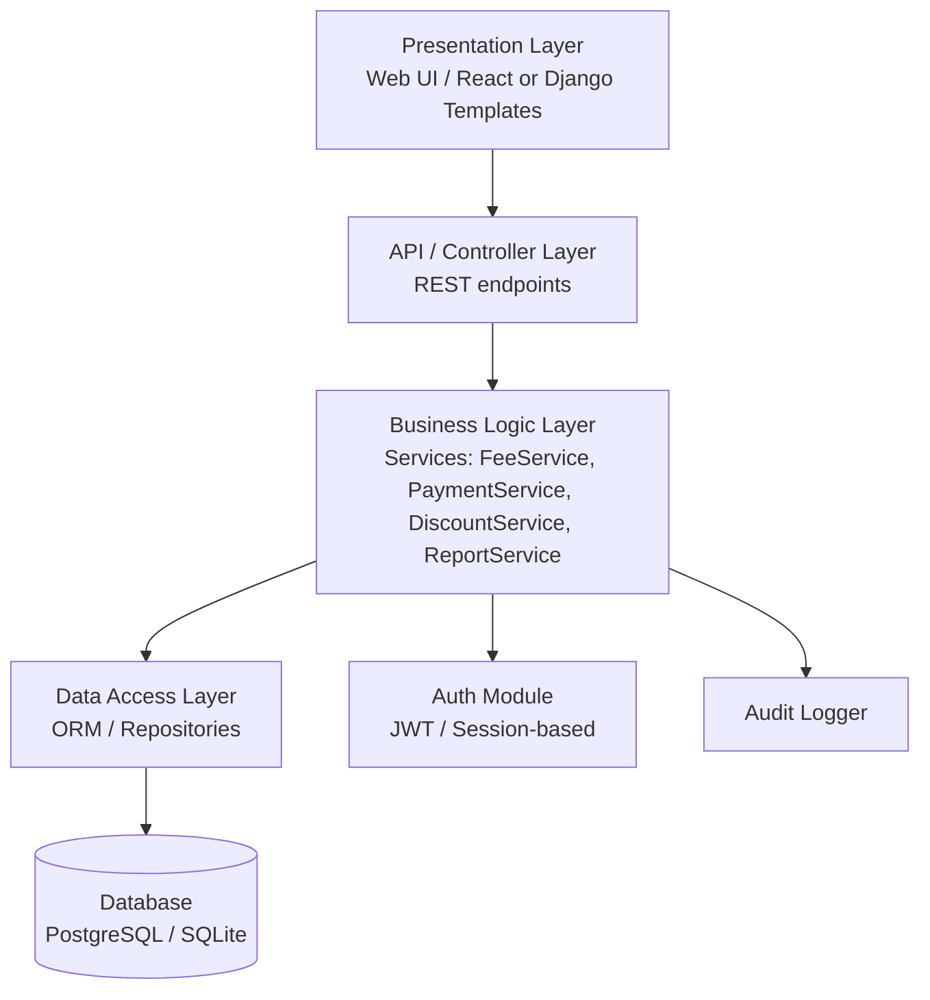
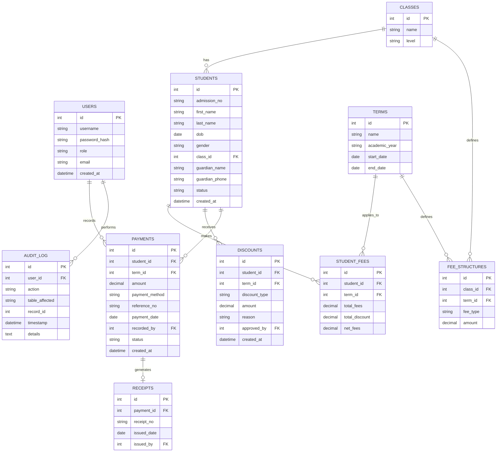

# School Fees & Payment Management System
## System Architecture & Database Schema

---

## 1. Architecture Overview

A layered (N-tier) architecture is recommended — it keeps business logic isolated from the database and UI, which makes the system much easier to unit test (a core requirement of your QA project).

**Why layered:**
- Presentation layer = UI testing (Selenium/Playwright)
- API layer = integration testing (Postman/pytest + requests)
- Business logic layer = **unit testing / white-box testing** (this is where BVA, EP, decision tables, statement & branch coverage apply)
- Data access layer = database testing
- Auth module = security testing target

---

## 2. Suggested Tech Stack

| Layer | Technology |
|---|---|
| Backend | Python + Django REST Framework (or Flask) |
| Frontend | ReactJS (or Django templates if you want to move faster) |
| Database | PostgreSQL (SQLite for local dev/testing) |
| Auth | JWT tokens, role-based access control |
| Testing | pytest, pytest-django, coverage.py, Selenium/Playwright, Locust (performance) |
| CI (optional) | GitHub Actions to auto-run test suite |

---

## 3. Core Modules

1. **Auth & User Management** — roles: `admin`, `bursar`, `parent`
2. **Student Registration** — CRUD
3. **Class/Grade & Term Management**
4. **Fee Structure** — set fees per class per term
5. **Discounts/Scholarships**
6. **Payment Recording**
7. **Balance Engine** — `Balance = Net Fees − Total Payments`
8. **Receipts**
9. **Search**
10. **Reports** — collections, outstanding balances, per-student statements
11. **Audit Log** — tracks edits/deletions (needed for your "unauthorized transaction editing" test case)

---

## 4. Entity Relationship Diagram

---

## 5. Table Definitions (SQL-style)

### 5.1 `users`
| Column | Type | Constraints |
|---|---|---|
| id | INT | PK, auto-increment |
| username | VARCHAR(50) | UNIQUE, NOT NULL |
| password_hash | VARCHAR(255) | NOT NULL |
| role | ENUM('admin','bursar','parent') | NOT NULL |
| email | VARCHAR(100) | UNIQUE |
| created_at | TIMESTAMP | DEFAULT now() |

### 5.2 `classes`
| Column | Type | Constraints |
|---|---|---|
| id | INT | PK |
| name | VARCHAR(30) | NOT NULL, e.g. "Form 1A" |
| level | VARCHAR(20) | e.g. "Secondary" |

### 5.3 `terms`
| Column | Type | Constraints |
|---|---|---|
| id | INT | PK |
| name | VARCHAR(20) | e.g. "Term 1" |
| academic_year | VARCHAR(9) | e.g. "2025-2026" |
| start_date | DATE | |
| end_date | DATE | |

### 5.4 `students`
| Column | Type | Constraints |
|---|---|---|
| id | INT | PK |
| admission_no | VARCHAR(20) | UNIQUE, NOT NULL |
| first_name | VARCHAR(50) | NOT NULL |
| last_name | VARCHAR(50) | NOT NULL |
| dob | DATE | |
| gender | ENUM('M','F','Other') | |
| class_id | INT | FK → classes.id |
| guardian_name | VARCHAR(100) | |
| guardian_phone | VARCHAR(20) | |
| status | ENUM('active','graduated','withdrawn') | DEFAULT 'active' |
| created_at | TIMESTAMP | DEFAULT now() |

### 5.5 `fee_structures`
| Column | Type | Constraints |
|---|---|---|
| id | INT | PK |
| class_id | INT | FK → classes.id |
| term_id | INT | FK → terms.id |
| fee_type | VARCHAR(30) | e.g. "Tuition", "Boarding", "Levy" |
| amount | DECIMAL(10,2) | NOT NULL, CHECK (amount >= 0) |

### 5.6 `student_fees` (derived/aggregated per student per term — this is your key **calculation table**)
| Column | Type | Constraints |
|---|---|---|
| id | INT | PK |
| student_id | INT | FK → students.id |
| term_id | INT | FK → terms.id |
| total_fees | DECIMAL(10,2) | sum of applicable fee_structures |
| total_discount | DECIMAL(10,2) | DEFAULT 0 |
| net_fees | DECIMAL(10,2) | = total_fees − total_discount |

> `Balance = net_fees − SUM(payments.amount WHERE status='confirmed')` — compute this in the service layer, not stored redundantly, to avoid data drift. This is your core white-box testing target.

### 5.7 `discounts`
| Column | Type | Constraints |
|---|---|---|
| id | INT | PK |
| student_id | INT | FK → students.id |
| term_id | INT | FK → terms.id |
| discount_type | ENUM('scholarship','sibling','staff','other') | |
| amount | DECIMAL(10,2) | CHECK (amount >= 0) |
| reason | TEXT | |
| approved_by | INT | FK → users.id |
| created_at | TIMESTAMP | DEFAULT now() |

### 5.8 `payments`
| Column | Type | Constraints |
|---|---|---|
| id | INT | PK |
| student_id | INT | FK → students.id |
| term_id | INT | FK → terms.id |
| amount | DECIMAL(10,2) | NOT NULL, CHECK (amount > 0) |
| payment_method | ENUM('cash','bank_transfer','mobile_money','cheque') | |
| reference_no | VARCHAR(50) | UNIQUE (helps catch duplicate transactions) |
| payment_date | DATE | NOT NULL |
| recorded_by | INT | FK → users.id |
| status | ENUM('confirmed','reversed','pending') | DEFAULT 'confirmed' |
| created_at | TIMESTAMP | DEFAULT now() |

> Note the `CHECK (amount > 0)` constraint — this directly supports your **negative payment** and **zero payment** test cases at the DB layer, in addition to application-layer validation (defense in depth — good talking point for your defense).

### 5.9 `receipts`
| Column | Type | Constraints |
|---|---|---|
| id | INT | PK |
| payment_id | INT | FK → payments.id, UNIQUE |
| receipt_no | VARCHAR(30) | UNIQUE, auto-generated |
| issued_date | DATE | DEFAULT today |
| issued_by | INT | FK → users.id |

### 5.10 `audit_log`
| Column | Type | Constraints |
|---|---|---|
| id | INT | PK |
| user_id | INT | FK → users.id |
| action | VARCHAR(50) | e.g. "EDIT_PAYMENT", "DELETE_STUDENT" |
| table_affected | VARCHAR(50) | |
| record_id | INT | |
| timestamp | TIMESTAMP | DEFAULT now() |
| details | TEXT | old value → new value |

---

## 6. Key Business Rules (your test-design source material)

1. `total_fees` for a student = sum of `fee_structures` matching their `class_id` and `term_id`.
2. `net_fees = total_fees − total_discount`, and **must never go below 0** (edge case: discount > fees).
3. `Balance = net_fees − SUM(confirmed payments)`.
4. A payment **cannot** be recorded if it would make balance negative by more than the allowed overpayment policy (decide: reject overpayment, or allow it and carry credit — pick one and justify it in your report; it's a great decision-table scenario).
5. Only `admin` role can edit or delete a **confirmed** payment; edits create an `audit_log` entry and set status to `reversed` + new corrected entry (never silently overwrite — this is what makes your "unauthorized transaction editing" test meaningful).
6. `reference_no` uniqueness enforces duplicate-transaction prevention at the DB level.
7. Receipts are only generated for `status = 'confirmed'` payments.

---

## 7. Mapping Architecture to Testing Activities

| Layer | Testing Technique |
|---|---|
| Business Logic (Balance/Payment services) | Unit testing, BVA, EP, Decision Tables, Statement/Branch Coverage |
| API Layer | Integration testing, Postman/pytest automation |
| Database constraints | Database testing (constraint violations, duplicate keys) |
| Auth module | Security testing (SQLi, broken access control, JWT tampering) |
| Full stack under load | Performance testing (Locust/JMeter — e.g. 100 concurrent payment submissions) |
| UI | Selenium/Playwright UI test suite |
